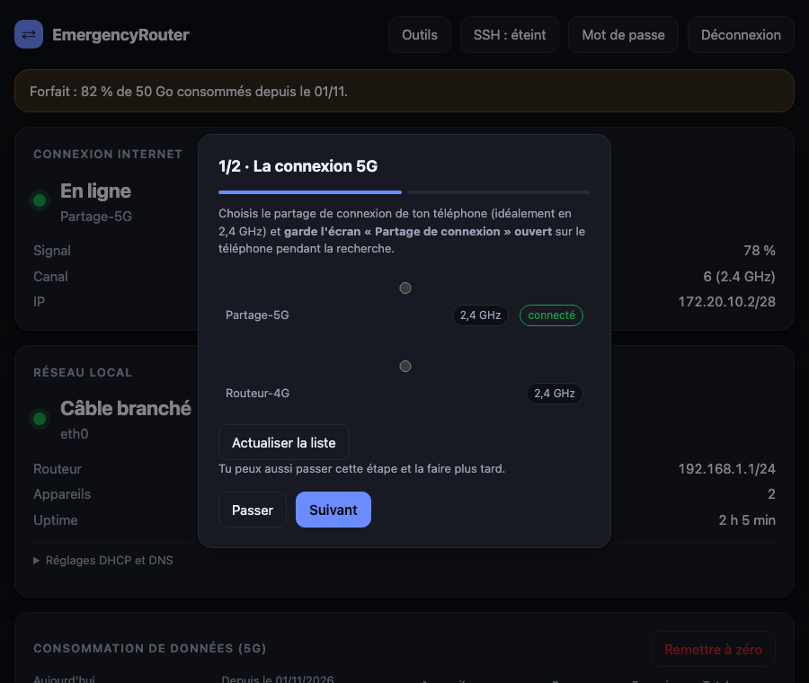
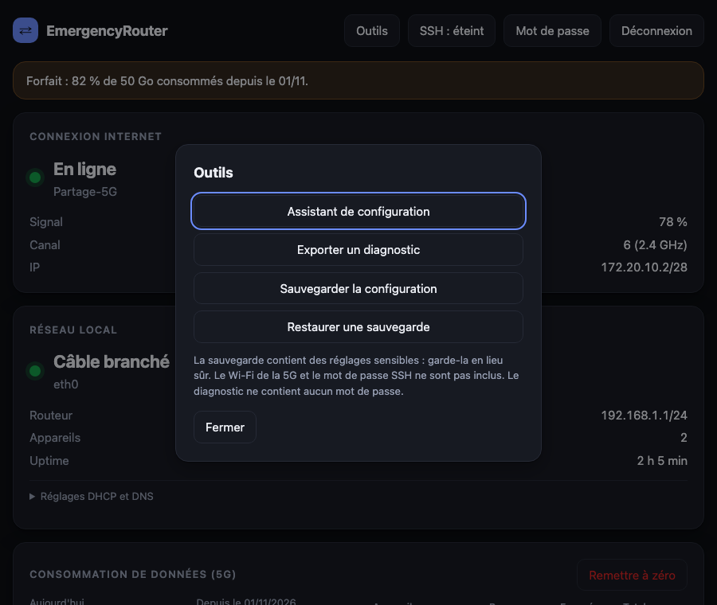
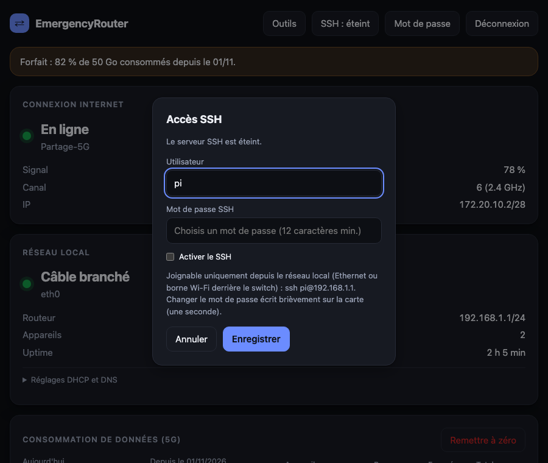

# EmergencyRouter

Routeur de secours tout-en-un pour Raspberry Pi (3, 4, 5) quand la fibre tombe.
Le Wi-Fi du Pi sert **uniquement** à joindre la 5G partagée de ton téléphone. Le réseau local passe par Ethernet : le Pi
fait DHCP/DNS et NAT sur `eth0`, vers un switch où tu branches ta borne Wi-Fi (UniFi…), configurée de façon indépendante
avec le SSID et le mot de passe de ta box.

```
Internet ← 5G ← wlan0 ┐
                      [ Pi ] ── eth0 (192.168.1.1) → switch → borne Wi-Fi (UniFi…) + appareils filaires
```

## Aperçu

Captures réalisées avec des données fictives (`python3 tests/ui/screenshots.py`).


| Thème clair | Mobile |
|---|---|
|  |  |

| Assistant de premier démarrage | Outils | Accès SSH |
|---|---|---|
|  |  |  |

L'interface suit le thème clair ou sombre de l'appareil et s'adapte aux petits écrans.

## Installation

### Image prête à flasher (recommandé)

Raspberry Pi OS Lite (Debian 13 « Trixie », 64 bits) avec tout préinstallé, une **partition de données séparée** et
le **système en lecture seule** : on peut couper le courant à tout moment.

```
./build-image.sh        # Docker requis, ~25 Go libres dans la VM Docker ; résultat : dist/*.img.xz + SHA256SUMS
```

1. Flasher avec Raspberry Pi Imager (« Utiliser un fichier personnalisé »). Le compte `pi` est déjà dans l'image
   (voir « Accès SSH ») : **ne règle pas d'utilisateur dans l'Imager**. Vérifie l'empreinte avec
   `shasum -a 256 -c SHA256SUMS`.
2. Branche le port Ethernet du Pi sur ton switch (ou directement sur un ordinateur réglé en DHCP).
3. Ouvre **https://192.168.1.1/** (ou `https://erouter.local/`) : le navigateur avertit que le certificat est auto-signé
   (normal : compare l'empreinte SHA-256 affichée en bas de la page), choisis le mot de passe admin, puis suis l'assistant :
   Wi-Fi de la 5G (garde l'écran « Partage de connexion » ouvert sur le téléphone).
   Une réinstallation (reflash) efface le Wi-Fi de la 5G enregistré : il faut le choisir de nouveau.

### Accès SSH

Éteint par défaut. Pour l'activer, dans l'interface, bouton **« SSH »** en haut de la page : choisis un mot de passe
(12 caractères minimum), coche « Activer le SSH » et enregistre. Puis :

```
ssh pi@192.168.1.1        # depuis le réseau local (Ethernet ou borne Wi-Fi)
```

- Le SSH n'est joignable que depuis le **réseau local** (Ethernet ou borne Wi-Fi derrière le switch), jamais depuis l'uplink (Wi-Fi de la box, 5G).
- Le compte est `pi` (réglable au build avec `SSH_USER=nom`) ; l'image n'a ni mot de passe par défaut ni clé : tant que tu n'as
  rien défini dans l'interface, personne ne peut se connecter. `sudo` demande ce même mot de passe.
- Le mot de passe est refusé s'il est trop court ou prévisible (contient le nom du compte, « password », « azerty »…).
- Changer le mot de passe repasse le système en écriture **une seconde**, puis le reverrouille. Le réglage « activé ou non »
  est mémorisé dans `/data` : il survit aux redémarrages, sans toucher au système.
- Protections : `root` interdit, 3 essais maximum, 12 nouvelles connexions par minute, pas de redirection de ports.
- `NO_ADMIN_USER=1 ./build-image.sh` construit une image sans compte (à créer alors avec Raspberry Pi Imager).
- Après un reflash, `ssh-keygen -R 192.168.1.1` (et `-R erouter.local`) évite l'avertissement « clé d'hôte modifiée ».

### Installation manuelle sur Raspberry Pi OS Lite

Copier ce dossier sur le Pi puis `sudo ./install.sh`. Fais-le **avant** d'en avoir besoin (il télécharge des paquets).
Sans l'image il n'y a pas de partition de données séparée : la protection de la carte SD n'est pas disponible.

## Fonctions

| Fonction | Où | Ce qu'elle fait | Coût |
|---|---|---|---|
| **Consommation de données** | carte « Consommation » | octets reçus/envoyés sur la 5G : aujourd'hui, depuis le renouvellement du forfait, par appareil ; barre de progression et alerte à un seuil | aucune donnée ; une écriture dans `/data` toutes les 10 min |
| **Qualité de la connexion** | carte « Qualité » | latence, pertes, signal et débit sur 24 h | en mémoire seulement (perdu au redémarrage) |
| **Test de débit** | carte « Test de débit » | débit descendant/montant, latence, gigue, pertes ; propose d'utiliser les débits pour l'anti-latence | environ **35 Mo** par test, sur demande ; contacte `speed.cloudflare.com` |
| **Blocage des publicités** | carte « Économies » | bloque ~77 000 domaines publicitaires et de traçage au niveau DNS ([StevenBlack/hosts](https://github.com/StevenBlack/hosts), licence MIT, version épinglée dans `erouter/data/blocklist.SOURCE`) | décompressée en mémoire ; peut gêner quelques sites |
| **Anti-latence (CAKE)** | carte « Économies » | évite que la connexion devienne très lente quand quelqu'un télécharge (envoi + réception, équité par appareil) | à régler un peu sous les débits réels de la 5G |
| **Plafond par appareil** | carte « Économies » | limite le débit d'un appareil (suivi par son adresse MAC, même si son IP change) | jusqu'à 16 appareils ; plafond **approximatif** (à ± 30 % près) |
| **Diagnostic** | Outils | un fichier avec l'état, la configuration **sans mot de passe**, le réseau et les journaux, à joindre à une demande d'aide | relis-le : il contient des noms de réseaux, des adresses IP et MAC |
| **Sauvegarde / restauration** | Outils | exporte et réimporte la configuration (forfait, plafonds, mot de passe admin) | le fichier contient l'empreinte du mot de passe admin : garde-le en lieu sûr ; le Wi-Fi 5G et le SSH ne sont pas inclus |
| **Assistant de premier démarrage** | s'ouvre seul | 2 étapes : Wi-Fi de la 5G, puis rappel de configurer la borne Wi-Fi à part | — |
| **Chien de garde** | automatique | le Pi redémarre seul s'il se fige ; l'agent est relancé s'il ne répond plus | — |

## Limites à connaître

- Pi 3B et Zero 2 W : 2,4 GHz uniquement. Pi 3B+/4/5 : 2,4 et 5 GHz.
- **Ne branche pas le Pi en même temps que la box fibre sur le même réseau** (deux serveurs DHCP, même IP).
- **Pas de câble, pas de réseau local** : l'interface affiche « Câble absent » (et un avertissement) tant que `eth0` n'a pas de liaison.
- Au premier accès après un reflash, il faut un câble : la borne Wi-Fi n'existe pas encore tant que tu ne l'as pas configurée.
- Pas de pile dans le Pi : au démarrage hors-ligne l'heure peut être fausse jusqu'à la synchronisation (sans effet sur le routage ; la consommation est comptée mais « non datée » jusque-là).
- **L'économie d'énergie Wi-Fi reste coupée** sur `wlan0` (sinon la liaison avec le téléphone devient instable : latence, pertes). L'agent la coupe et la revérifie toutes les 30 s ; NetworkManager est configuré dans le même sens (`91-erouter-wifi.conf`).
- **Pas de swap sur la carte SD** : Raspberry Pi OS crée par défaut un fichier `/var/swap` (écriture différée du swap compressé) qui empêche le verrouillage en lecture seule et use la carte. EmergencyRouter impose un swap compressé en mémoire seulement (`Mechanism=zram`).

## Architecture

| Service | Droits | Rôle |
|---|---|---|
| `erouter-data` (`scripts/erouter-data`) | root, au démarrage | vérifie, répare ou recrée la partition de données `/data`, puis la monte |
| `erouter-agent` (`agent.py`, `agentd.py`, `lan.py`, `tls.py`, `fs.py`) | root | adresse de `eth0`, dnsmasq, nftables ; surveille Internet ; certificat HTTPS ; verrouillage du système ; seul à écrire la config |
| `erouter-web` (`web.py`, `webd.py`, `static/`) | utilisateur `erouter`, système en lecture seule, seul droit : ports 80/443 | API Flask + interface (sans dépendance externe, fonctionne hors-ligne), servie en HTTPS par gunicorn ; le port 80 redirige vers HTTPS |
| `rpc.py` | | socket local `/run/erouter/agent.sock` (0660 root:erouter) ; l'agent n'expose que 14 méthodes et valide chaque paramètre |

Service supplémentaire : `erouter-dnsmasq`. Détails et limites : [SECURITY.md](SECURITY.md).

Config : `/data/erouter/config.yaml` (voir `config.example.yaml`), modifiable depuis l'interface.
Logs : `sudo journalctl -u erouter-data -u erouter-agent -u erouter-web -u erouter-dnsmasq -n 80`

## Protection de la carte SD

Un routeur de secours dort longtemps puis subit une coupure de courant. L'image a donc trois partitions :

| Partition | Contenu | Écrite ? |
|---|---|---|
| `boot` (FAT, 512 Mo) | noyau, `cmdline.txt` | jamais en fonctionnement |
| `rootfs` (ext4, ~2,4 Go) | le système | **lecture seule** une fois le démarrage terminé |
| `erdata` (ext4, 256 Mo) | config, Wi-Fi enregistrés, état de NetworkManager, certificat HTTPS | oui, quand tu enregistres un réglage |

- Une coupure de courant ne peut donc abîmer que `erdata`, qui est **vérifiée à chaque démarrage** (`e2fsck -f`) :
  réparée si possible, **recréée avec la config par défaut** sinon (l'interface t'en avertit). Le démarrage n'est jamais bloqué.
- Le système n'est écrit que pendant le démarrage (le temps que tout soit lancé), puis verrouillé ; seule exception : une seconde quand tu changes le mot de passe SSH.
- La racine n'est **pas** agrandie au premier démarrage (le mot `resize` est retiré de `cmdline.txt`) : le reste de la carte est inutilisé.
- Journaux et baux DHCP en RAM, pas de swap, pas de mises à jour automatiques.
- L'état se voit et se règle en ligne de commande : `sudo erouter-fs status | lock | unlock`. L'interface n'affiche que les
  avertissements (partition de données réparée ou recréée).
- **Mettre à jour le système** : `sudo erouter-fs unlock && sudo reboot`, puis `sudo apt update && sudo apt upgrade`,
  puis `sudo erouter-fs lock`.
- **Sortie de secours** : retire la carte, ouvre `cmdline.txt` sur la partition de boot (visible depuis un Mac) et ajoute
  `erouter.unlock` à la fin de la ligne : le système reste alors en écriture.
- Contrepartie : un dossier personnel (`~`) n'est pas modifiable quand le système est verrouillé.

## HTTPS

Certificat auto-signé créé par l'agent au premier démarrage (EC P-256, valable 825 jours, renouvelé 60 jours avant
l'échéance ou si l'adresse IP du routeur change), stocké dans `/data` : il reste le même d'un démarrage à l'autre, donc
l'avertissement du navigateur n'apparaît qu'**une fois par appareil**. Il couvre `erouter.local`, `erouter` et l'IP du routeur.
L'empreinte SHA-256 s'affiche en bas de l'interface pour la comparer lors de la première visite.
Si le certificat ne peut pas être créé, l'interface reste servie en HTTP (avec un avertissement) plutôt que d'être inaccessible.

## Développement

```
make check          # pyflakes + shellcheck + tests unitaires (120)
make ui-test        # l'interface jouée dans un vrai Chrome sans écran (6 scénarios : tableau de bord, outils, assistant, test de débit, économies, mobile)
make integration    # vérifications dans un vrai Debian 13 (Docker, conteneur privilégié) :
                    # vrais disques pour la partition de données (saine, corrompue, détruite), post-traitement d'image,
                    # HTTPS de bout en bout avec gunicorn, pare-feu avec du vrai trafic (compteurs, plafonds mesurés, usurpation),
                    # CAKE sur une vraie interface, test de débit contre un serveur local, blocage des pubs avec un vrai dnsmasq,
                    # diagnostic sans secret, unités systemd, shellcheck
make image          # image flashable
```
La CI GitHub exécute les vérifications statiques et les tests unitaires. Ce qui n'est pas testé automatiquement :
l'uplink Wi-Fi (matériel), le démarrage réel de l'image et le verrouillage du système sur un Pi.

## Feuille de route

- [ ] Image construite automatiquement par GitHub Actions
- [ ] IPv6
- [ ] Mise à jour de l'application sans reflasher
