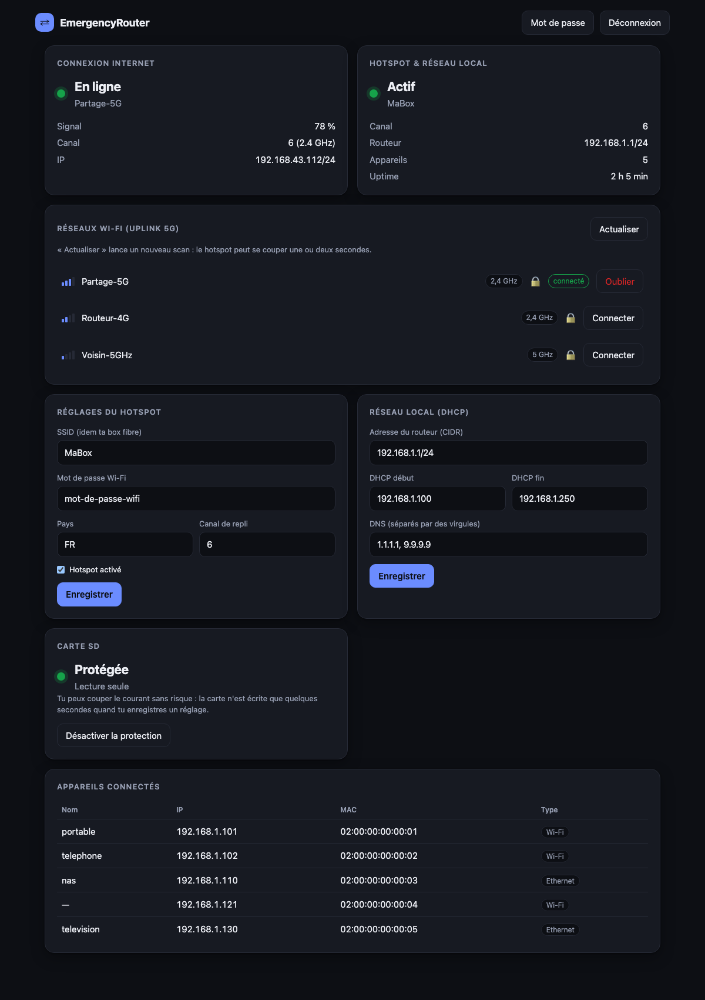
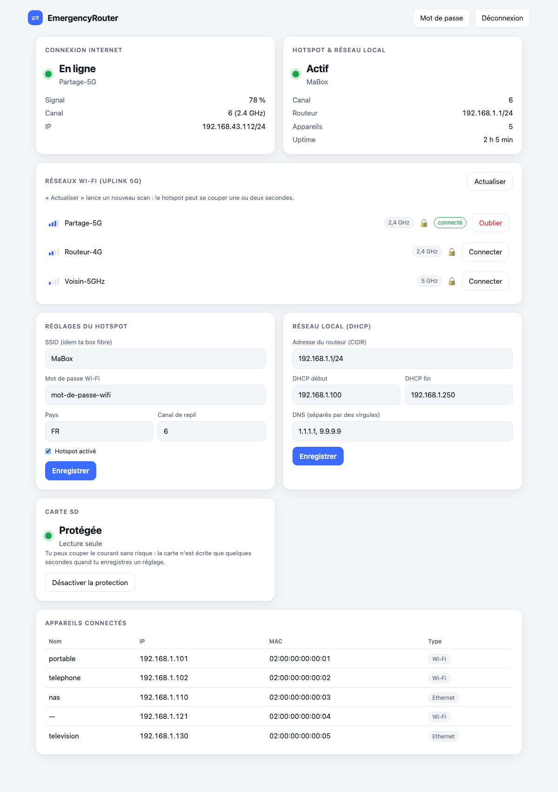
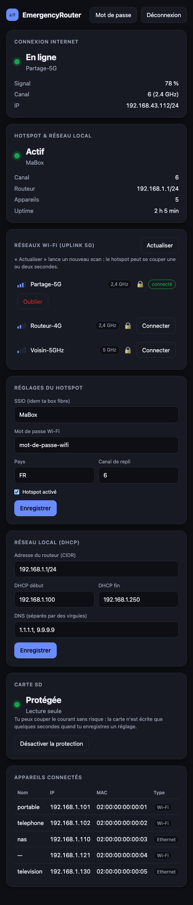
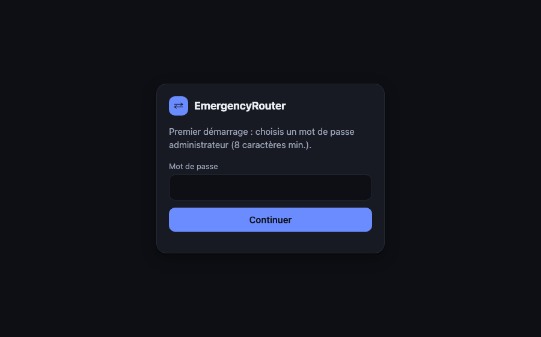

# EmergencyRouter

Routeur de secours tout-en-un pour Raspberry Pi (3, 4, 5) quand la fibre tombe.
Le Pi se connecte en Wi-Fi à ta 5G, et **avec la même puce Wi-Fi** diffuse un hotspot portant le
SSID/mot de passe de ta box (interface virtuelle `ap0`). Il fait aussi DHCP/DNS et NAT pour le switch en Ethernet.

```
Internet ← 5G ← wlan0 ┐
                      [ Pi ] ── br0 (192.168.1.1) ── eth0 → switch → clients
                  ap0 ┘  (hotspot, même SSID que la box)
```

## Aperçu

Captures réalisées avec des données fictives.



| Thème clair | Mobile | Premier démarrage |
|---|---|---|
|  |  |  |

L'interface suit le thème clair ou sombre de l'appareil et s'adapte aux petits écrans.

## Installation

1. Flasher **Raspberry Pi OS Lite** (64 bits, Bookworm/Trixie) avec Raspberry Pi Imager (SSH activé, accès réseau pour l'installation).
2. Copier ce dossier sur le Pi, puis : `sudo ./install.sh`
3. Ouvrir `http://192.168.1.1/` depuis le LAN, choisir un mot de passe admin, puis choisir le Wi-Fi de la 5G et régler le hotspot.

Fais l'installation **avant** d'en avoir besoin (elle télécharge des paquets).

## Image prête à flasher (Debian 13 Trixie 64 bits, Lite)

Construite avec [pi-gen](https://github.com/RPi-Distro/pi-gen) (branche `arm64`) dans Docker, sans émulation sur un Mac Apple Silicon :

```
./build-image.sh        # ~25 Go libres dans la VM Docker ; résultat dans dist/*.img.xz
```

Flasher avec Raspberry Pi Imager (« Utiliser un fichier personnalisé ») ; utilisateur et clé SSH se règlent dans l'Imager,
l'image n'embarque aucun mot de passe. Au premier démarrage, le hotspot **`ERouter-Setup`** (mot de passe `erouter-setup`)
sert à la configuration : ouvre `http://192.168.1.1/` (ou `http://erouter.local/`), choisis le mot de passe admin, puis règle
le vrai SSID/mot de passe et le Wi-Fi de la 5G. Change ces valeurs tout de suite.

## Limites à connaître

- **Même puce = même canal.** Le hotspot est calé sur le canal de la connexion 5G ; l'agent le suit automatiquement
  (le hotspot redémarre brièvement si le canal change).
- Si le partage de connexion du téléphone est en **5 GHz sur un canal DFS (52-144)**, le hotspot ne peut pas démarrer.
  Mets le partage en **2,4 GHz** (le plus fiable), ou en 5 GHz sur un canal bas (36-48).
- Pi 3B et Zero 2 W : 2,4 GHz uniquement. Pi 3B+/4/5 : 2,4 et 5 GHz.
- **Ne branche pas le Pi en même temps que la box fibre sur le même réseau** (deux serveurs DHCP, même IP).
- Les débits d'un Wi-Fi unique partagé entre uplink et hotspot sont réduits ; pour de meilleurs résultats, mets les
  appareils fixes sur Ethernet via le switch.

## Architecture

Deux services, pour qu'une faille dans la page web ne donne pas root :

| Service | Droits | Rôle |
|---|---|---|
| `erouter-agent` (`agent.py`, `agentd.py`, `lan.py`, `fs.py`) | root | pont `br0`, `ap0`, hostapd, dnsmasq, nftables ; suit le canal de l'uplink ; surveille Internet ; seul à écrire sur la carte |
| `erouter-web` (`web.py`, `webd.py`, `static/`) | utilisateur `erouter`, système en lecture seule, seul droit : port 80 | API Flask + interface (sans dépendance externe, fonctionne hors-ligne), servie par waitress |
| `rpc.py` | | socket local `/run/erouter/agent.sock` (0660 root:erouter) ; l'agent n'expose que 8 méthodes et valide chaque paramètre |

Services supplémentaires : `erouter-hostapd`, `erouter-dnsmasq`. Config : `/etc/erouter/config.yaml`
(voir `config.example.yaml`), modifiable depuis l'interface. Détails et limites : [SECURITY.md](SECURITY.md).

Logs : `sudo journalctl -u erouter-agent -u erouter-web -u erouter-hostapd -u erouter-dnsmasq -n 80`

## Protection de la carte SD

Un routeur de secours dort longtemps puis subit une coupure de courant : une fois le démarrage terminé,
l'agent **remonte la racine du système en lecture seule**. On peut donc couper le courant à tout moment : au rallumage,
le routeur est directement opérationnel (hotspot, DHCP, Wi-Fi 5G enregistré).

- Quand tu enregistres un réglage ou un Wi-Fi, l'agent repasse la carte en écriture **quelques secondes**, `fsync`, puis la reverrouille.
  Ne coupe pas le courant pile à ce moment-là.
- Journaux en RAM, baux DHCP en RAM, pas de swap, pas de mises à jour automatiques.
- L'état est visible (et réglable) dans l'interface, carte « Carte SD », ou en ligne de commande :
  `sudo erouter-fs status | lock | unlock`.
- **Mettre à jour le système** : `sudo erouter-fs unlock`, `sudo apt update && sudo apt upgrade`, puis `sudo erouter-fs lock`.
- **Sortie de secours** : si le verrouillage posait problème, retire la carte, ouvre `cmdline.txt` sur la partition de boot
  (visible depuis un Mac) et ajoute `erouter.unlock` à la fin de la ligne : la carte reste alors en écriture.
- L'image est livrée avec la protection activée ; une installation manuelle (`install.sh`) la laisse désactivée jusqu'à `sudo erouter-fs lock`.

## Développement

```
make check      # pyflakes + shellcheck + tests (38 tests)
make image      # image flashable (Docker)
```
La CI GitHub exécute les mêmes vérifications. Aucun test ne touche au système réel : l'agent est simulé, sauf la
validation et l'écriture de la configuration.

## Feuille de route

- [ ] HTTPS (certificat auto-signé) pour l'interface
- [ ] Overlay en lecture seule avec partition de données séparée (si le verrouillage actuel ne suffit pas)
- [ ] Image construite automatiquement par GitHub Actions
